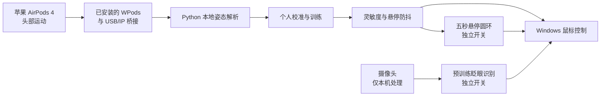

# NodLink Windows：用苹果耳机控制 Windows 鼠标

**Windows 11 + AirPods 4，让头部动作成为一种新的鼠标输入。**

转头移动指针，眨眼完成单击，悬停五秒按住、拖动、再悬停松开。NodLink 把苹果耳机中的头部运动数据接入 Windows，并提供中文界面、个人自动训练、灵敏度调节与悬停防抖。

已有 AirPods 4，可以探索耳机头控这条输入路线；眨眼功能另需摄像头。当前项目是**有真实设备验证的 Python 桌面原型**，头追依赖已安装的 WPods 与 USB/IP 桥接，尚未提供开箱即用安装器。

**适用系统：Windows 11｜验证耳机：普通版 AirPods 4｜开发语言：Python｜界面：中文**

[功能亮点](#功能亮点) · [快速开始](#快速开始) · [首次使用](#首次使用) · [验证与兼容范围](#验证与兼容范围) · [后续计划](#打包与后续计划)

## 为什么做这个项目

苹果耳机的头部追踪，为 Windows 桌面带来了一种值得探索的交互方式：**让耳机除了播放声音，也能成为控制电脑的入口。**

NodLink 关注从“读到传感器数据”到“能稳定停住并完成操作”的完整路径：确认动作方向、训练个人范围、降低抖动，再把移动、单击和拖拽接在一起。它适合关注替代输入方式、耳机传感器应用和 Windows 桌面交互的开发者与体验者。

## 功能亮点

| 功能 | 可以做什么 |
| --- | --- |
| 🎧 苹果耳机头控 | 读取普通版 AirPods 4 的真实头部姿态，将转头、抬头和低头映射为指针移动 |
| 🧭 个人自动训练 | 102 秒引导采集，拟合横纵方向、舒适范围与噪声参数；独立复测通过并经本人确认后才应用 |
| 🎚️ 三路灵敏度 | 总体、横向、纵向独立调节，运行时可调整并保存在本机 |
| 🎯 悬停防抖 | 三帧中值、固定悬停锚点和解锁迟滞，减轻尖峰与缓慢漂移；提供防抖强度调节 |
| 👁️ 眨眼单击 | 摄像头 + MediaPipe 官方预训练模型，无需训练个人眨眼模型；独立开关与只计数测试 |
| ⏳ 五秒悬停长按 | 独立开关、逐渐填满的圆环；五秒按住，移动后再悬停五秒松开，支持拖动 |
| 🖥️ 硬件检测 | 查看电脑环境、Windows 已登记蓝牙设备、桥接状态、运行日志并导出报告 |
| 🛟 停止与恢复 | 停止按钮、失联停控、角落保护、F8 松开自有长按；尝试在退出后恢复普通蓝牙 |

眨眼单击与悬停长按**默认关闭、分别开启**。程序启动不会自动移动鼠标；训练与验证窗口也不会操作桌面指针。

### 五秒悬停，完成按住与松开


稳定悬停 → 蓝色圆环填满 → 左键按住 → 移动到目标 → 再悬停五秒 → 左键松开。

按住期间使用橙色提示，并暂停眨眼单击。完成一次操作后，需要离开原悬停范围才会重新计时，避免在同一点反复触发。关闭开关、停止控制或数据失联时，会松开 NodLink 自己按下的左键；也可按 **F8** 或点“立即松开左键”。

## 方案如何工作



耳机负责头部姿态，摄像头负责眨眼。**听歌连接正常不等于运动通道已经就绪**；读取头追需要桥接建立独立通道，程序会通过真实运动短测检查状态。

## 快速开始

### 1. 准备环境

- Windows 11、64 位 Python 3.12；本地开发验证使用 Python 3.12.3。
- 普通版 AirPods 4，以及兼容的蓝牙与桥接环境。
- 眨眼单击为可选功能，需要可被 Windows 正常识别的摄像头。

获取项目源码：

```powershell
git clone https://github.com/HAOJ1E/NodLink-Python.git
cd NodLink-Python
```

在项目目录执行：

```powershell
py --list
python --version
where.exe python
```

确认已有 Python 3.12 后创建环境并安装依赖：

```powershell
py -3.12 -m venv .venv
.\.venv\Scripts\python.exe -m pip install -r requirements.txt
.\.venv\Scripts\python.exe -m pip check
```

若只有其他版本，先确认兼容性；不要因为 `py -3.11` 找不到解释器就重复安装。仓库不包含 `.venv`、个人配置或本机验证报告。

### 2. 打开中文检测界面

双击 `start.bat`，或运行：

```powershell
.\.venv\Scripts\python.exe main.py
```

无需头追桥接也可以先查看电脑环境和已登记的蓝牙设备。主窗口只检查状态，不会自动读取运动流或控制鼠标。

### 3. 按需安装眨眼组件

双击 `install_blink.bat`，或执行：

```powershell
.\.venv\Scripts\python.exe -m pip install -r requirements-blink.txt
.\.venv\Scripts\python.exe download_blink_model.py
```

脚本从 Google 官方固定版本地址下载模型，生成本机哈希清单。模型二进制不放入 Git 仓库。来源见 [模型说明](models/MODEL-SOURCE.md)。

## 首次使用

1. **准备兼容桥接。** 当前真实接入基于 WPods v0.3.2 与 USB/IP 0.9.8.1。它们是单独安装的外部依赖，NodLink 不自动安装内核驱动或改变系统安全设置。已验证硬件范围见下一节。
2. **启用头追。** 从主界面打开控制窗口，点击“启用头追桥接”。这会短暂断开蓝牙；程序检查适配器、请求耳机重连并进行约四秒真实运动短测。失败会尝试恢复普通蓝牙。
3. **完成本机动作验证。** 保持桥接窗口打开，运行 `validate_motion.bat`，按提示完成五秒准备及 54 秒动作验证。只有确实完成动作且检查通过时，才确认结果。该步骤不移动鼠标。
4. **重新打开控制窗口。** 关闭验证和控制窗口，再打开控制窗口并按需启用桥接，让程序加载本机新验证记录；关闭原控制窗口时会尝试恢复普通蓝牙。
5. **进行个人训练。** 点击“自动训练（102 秒）”，按提示完成小幅动作、舒适范围与独立复测。确认应用后保存个人参数；中断或失败保留旧配置。
6. **手动启动鼠标。** 勾选佩戴与准备确认，点击启动；前三秒正视校准期间保持不动。可从较低灵敏度开始，调节悬停防抖。
7. **选择辅助操作。** 眨眼先用“只计数，不点击”测试；需要拖拽时再打开“五秒悬停长按”。两项功能可分别关闭。

`control_mouse.bat` 可以直接打开待机控制窗口；`control_mouse.py --enable-bridge` 仅准备桥接并短测，不自动开始训练或移动指针。

## 验证与兼容范围

项目已经取得真实数据，以下是**单台开发电脑、单副普通版 AirPods 4** 的阶段结果，不代表所有电脑或耳机型号都已兼容：

| 验证项目 | 已观察结果 | 范围说明 |
| --- | --- | --- |
| 耳机动作验证 | 54 秒收到 1349 个候选帧、1346 个有效帧，约 25.02 Hz；用户确认完成对应动作 | 真实耳机数据，非模拟演示 |
| 个人训练 | 一次完整训练收到 2548 个有效帧，检查通过并由用户确认应用 | 训练误差不能当作屏幕像素精度 |
| 眨眼识别 | 真实 Chicony 摄像头在只计数模式观察到至少四次识别 | 尚未完成长期误触率评估 |
| 离线自动测试 | 本地 111 项测试通过 | 包括协议边界、失联停控、防抖、眨眼门控和悬停长按；鼠标按键测试使用替身 |
| 五秒长按与拖拽 | 计时、满圈、移动后松开、停止清理与 F8 已有自动测试 | 真实桌面拖拽手感仍需人工试用 |

当前桥接恢复逻辑针对 **Intel AX211（8087:0033）与既有 USB/IP 控制器**。AirPods 4 降噪版、其他耳机、其他蓝牙适配器及多显示器完整体验尚未验证。

本项目保留 PyAutoGUI 角落保护。头追输出避开四角各八像素区域；用实体鼠标移到角落仍可触发停止。连续约 0.7 秒没有有效新姿态会自动停控。

## 常见问题

**耳机能听歌，为什么不能头控？**

蓝牙音频与运动数据是不同通道。先检查桥接是否就绪，再检查真实运动短测与本机动作验证，不能仅凭配对名称认定传感器可用。

**提示通道占用或错误 170？**

从托盘完全退出 WPods 图形客户端，并停止其他 NodLink 窗口中的采集。图形客户端可能占用 AAP；不要把仍需使用的后台 WPodsService 与图形客户端混为一谈。NodLink 自身也使用跨进程采集锁避免争用。

**启用桥接后蓝牙暂时消失？**

桥接切换会影响普通蓝牙设备。可以点击“恢复普通蓝牙”，或正常关闭管理该桥接的控制窗口。恢复失败时保留窗口日志；退出守护只是尽力恢复，断电与系统崩溃后的恢复尚未验证。

**Windows 返回 3010，要求重启？**

保存工作后选择 Windows 的“重新启动”。程序记录系统启动时间，在同一次启动中不反复重置控制器。不要用修改驱动签名或系统安全设置解决。

**悬停还是容易抖？**

先完成个人训练，降低总灵敏度，再逐步增加防抖强度。防抖默认 65%；强度越高，小幅修正也可能越迟缓。它处理小范围噪声，不能保证所有人的动作或硬件条件都达到相同精度。

## 本地数据与默认行为

- 摄像头画面仅在本地子进程内存处理，不保存或上传；界面接收闭眼分数、人脸数量与时间戳。
- 个人配置保存在 `settings/`；训练与验证可能在 `reports/` 保存姿态数据，设备诊断报告也可能包含本机设备信息。两个目录均被 Git 忽略。
- 普通控制会话摘要只记录计数、状态与停止原因，不保存原始姿态帧或鼠标坐标。
- 默认不启用桥接、不移动鼠标、不打开摄像头，也不自动开始长按。

## 开发与测试

应用层全部使用 Python，模块拆分并附中文注释。采集仅保留最新帧，界面按约 30 Hz 消费；模型推理、训练拟合与文件保存分别在子进程或后台线程中运行，减少界面积压。

```powershell
$env:QT_QPA_PLATFORM = "offscreen"
$env:PYTHONIOENCODING = "utf-8"
.\.venv\Scripts\python.exe -m unittest discover -s tests -v
```

GitHub 自动测试使用 Windows 与 Python 3.12，不依赖真实耳机、摄像头或桥接驱动。离线测试不能替代硬件兼容性与真实操作评估。

| 位置 | 内容 |
| --- | --- |
| `main.py` | 检测界面入口 |
| `nodlink/control_window.py` | 训练、灵敏度、眨眼与长按交互 |
| `nodlink/sensor_capture.py`、`nodlink/rtbuddy.py` | AAP 采集与运动消息解析 |
| `nodlink/motion_training.py` | 个人方向拟合与复测 |
| `nodlink/pointer_stabilizer.py` | 指针滤波与固定悬停锚点 |
| `nodlink/blink_detector.py`、`nodlink/blink_worker.py` | 眨眼时序判断与隔离推理 |
| `nodlink/dwell_hold.py`、`nodlink/dwell_overlay.py` | 长按状态机与进度圆环 |
| `nodlink/bridge_recovery.py` | 桥接准备、原生蓝牙恢复与退出守护 |
| `tests/` | 协议、控制门控、响应性与交互边界测试 |

## 打包与后续计划

`build_exe.bat` 提供 PyInstaller 目录包构建入口；如需包含眨眼功能，先安装可选依赖并下载模型。新增模型收集流程尚未完成 EXE 实测。**当前发布的是源码，不是经过验证的独立安装器；EXE 也不能替代桥接服务和驱动。**

- [x] 真实 AirPods 4 运动接入与动作验证
- [x] 个人训练、灵敏度与悬停防抖
- [x] 可单独开关的眨眼单击与五秒悬停长按
- [x] 中文检测界面、日志、报告与离线测试
- [ ] 更广的蓝牙硬件与耳机兼容性验证
- [ ] 长期稳定性、误触率与真实拖拽体验评估
- [ ] 多显示器及不同缩放设置的完整验证
- [ ] EXE 构建验证与可选择桥接依赖的安装流程

## 参与与收藏

如果你也希望 **Windows 用上苹果耳机的头部追踪能力**，欢迎点亮 ⭐ 收藏项目，关注后续兼容性与交互改进。

欢迎在议题中分享耳机型号、蓝牙适配器、Windows 版本与具体复现步骤；提交日志前请自行去掉个人设备标识。真实硬件反馈能帮助这条方案从“本机可用”走向更多人的桌面。

第三方实现、参考代码与模型来源见 [第三方组件说明](docs/THIRD_PARTY.md)。本项目不是 Apple 官方产品。
